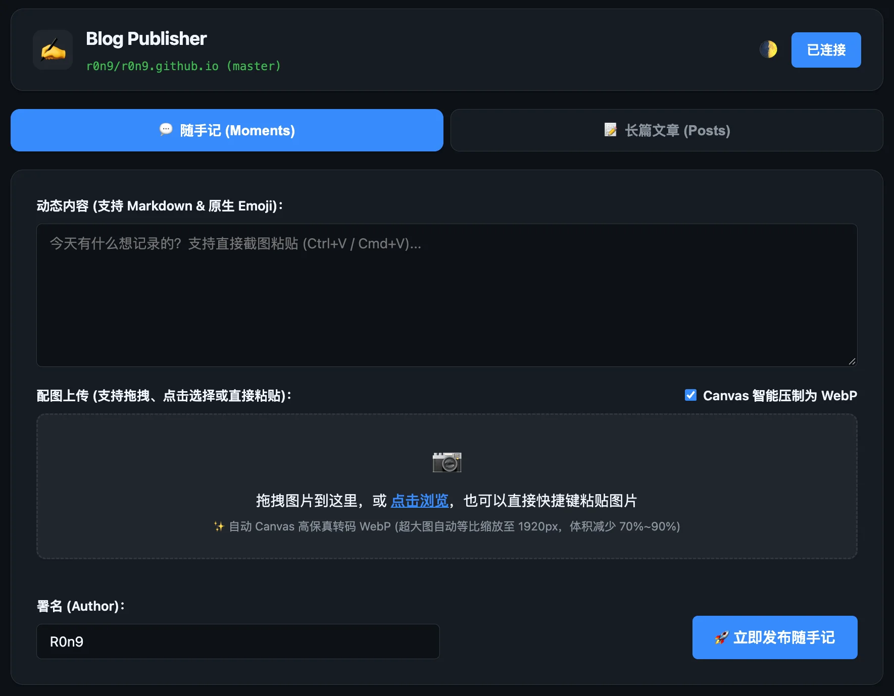

# R0n9's Blog Publisher (博客直发管理后台)

轻量、极速、无外部依赖的静态博客内容在线发布服务。让你无需打开本地编辑器或 Git 终端，即可在任何设备（PC、手机、平板）的浏览器中随手记录碎碎念（Moments）或编写长篇文章（Posts），并直接通过 **GitHub REST API** 原子提交并推送到本仓库的 `master` 分支，全自动触发 GitHub Pages / GitHub Actions 部署。

<p align="center">
  
</p>

---

## ✨ 核心特性

1. **GitHub Git Data API 原子直写**
   - 彻底摒弃本地执行 `git commit` / `git push` 命令的笨重方式。
   - 上传的配图通过 GitHub Blob API 写入，与生成的 Markdown 文件在同一个 Git Tree 中合并，**生成单个原子 Commit**。单次发布仅触发一次 CI/CD，无中间脏状态。
2. **零第三方依赖 (Zero External Dependencies)**
   - 纯 Go 1.21+ 标准库编写（`net/http`, `crypto/subtle`, `embed` 等），秒级编译，杜绝任何外部供应链风险。
   - 前端采用标准 Vanilla JS + CSS 原生实现，所有 HTML、CSS、JS 完全通过 `go:embed` 打包进单一独立二进制文件。
3. **极佳的移动端与桌面端体验**
   - 完美适配本博客的 Paper 主题风格，内置深色/明亮（Dark/Light）双主题随心切换。
   - **前端 Canvas 智能转码 WebP**：上传或粘贴的高清大图在浏览器端由 Canvas 自动等比缩放至 1920px 内并高保真转码为 `.webp`，图片体积普遍暴降 **70%~90%**（几 MB 的截图秒变 100~300 KB），且保留 GIF 动图多帧；实时在缩略图展示体积缩减比例。
   - **剪贴板截图一键粘贴**：无论在桌面还是手机端，随时按下 `Ctrl+V` / `Cmd+V` 截屏，即刻自动捕获图片并加入上传队列。
   - **双栏 Markdown 实时预览**：支持标题、代码块、引用、链接与图片的即时渲染。
4. **随手记 (Moments) 与文章 (Posts) 双模式切换**
   - **随手记**：快速发布碎碎念或生活点滴，配图自动存入 `static/images/moments/`，文档存入 `content/moments/`。
   - **长篇文章**：支持标题、摘要、分类、标签、草稿状态，自动存入 `content/posts/`，配图存入 `static/images/`。
5. **独占一行 URL 自动转换为精美书签卡片 (Telegram / Notion 风格)**
   - 在随手记或长文编辑器中，独占一行粘贴 URL，发布时服务端会自动抓取目标网页的 OpenGraph 标题、描述与封面图，直接转换为静态短代码 ``。
   - 100% 静态化保存入 Git 仓库，断网可读、永久保留，并完美适配 PaperMod 原生卡片样式。
6. **安全与权限防护**
   - `ADMIN_SECRET` 访问口令验证：使用 `crypto/subtle.ConstantTimeCompare` 进行恒定时间比较，防御时序侧信道攻击。
   - 客户端从始至终无法接触 `GITHUB_TOKEN`，PAT 令牌只存在于服务端内存与环境变量中。

---

## 🚀 快速开始

### 方式一：本地直接运行 (Go 1.21+)

1. 配置环境变量（**推荐：直接使用 `.env` 文件**）：
   - 将 `tools/publisher/.env.example` 复制为 `tools/publisher/.env`：
     ```bash
     cd tools/publisher
     cp .env.example .env
     ```
   - 编辑 `.env` 填入您的 `GITHUB_TOKEN` 和 `ADMIN_SECRET`。
   - **服务内置自动读取功能**：启动时会自动寻找当前目录或项目下的 `.env` 并加载，无需手动 `export`！

2. 直接运行服务：
   ```bash
   go run .
   ```
   *(或从博客根目录运行：`go run ./tools/publisher`)*

3. 打开浏览器访问：`http://localhost:13133`，输入口令即可开始创作发布！

---

### 方式二：Docker / Docker Compose 部署 (推荐部署至 NAS 或 VPS)

可以直接拉取由 GitHub Actions 自动构建的多架构镜像（无需本地编译），也可以基于源码本地构建：

1. **直接拉取官方 GHCR 镜像运行**：
   ```bash
   docker run -d \
     --name blog-publisher \
     --restart unless-stopped \
     -p 13133:13133 \
     --env-file .env \
     ghcr.io/r0n9/blog-publisher:latest
   ```

2. **使用 Docker Compose 部署**：
   进入 `tools/publisher/` 目录，编辑 `docker-compose.yml`：
   ```yaml
   services:
     blog-publisher:
       # 直接使用预构建镜像，或保留 build 源码构建：
       image: ghcr.io/r0n9/blog-publisher:latest
       container_name: blog-publisher
       restart: unless-stopped
       ports:
         - "13133:13133"
       environment:
         - GITHUB_TOKEN=ghp_your_personal_access_token_here
         - ADMIN_SECRET=your_super_secret_password_here
         - GITHUB_REPO=r0n9/r0n9.github.io
         - GITHUB_BRANCH=master
         - AUTHOR=R0n9
   ```

3. 启动容器：
   ```bash
   docker compose up -d
   ```

---

### 方式三：直接下载 GitHub Release 二进制文件

每次 `tools/publisher` 源码变更并推送到 `master` 时，GitHub Actions 会自动编译多架构独立二进制文件并发布在 Releases 页面：
- **Linux** (amd64 / arm64)
- **macOS** (Apple Silicon M系列 / Intel)
- **Windows** (amd64)

直接下载对应平台的压缩包解压并配置 `.env` 即可一键直接运行。

---

### 方式四：Cloudflare Workers 边缘免服务器部署 (推荐：0 成本 / 0 运维)

如果您没有云服务器或常开的 NAS，可以直接将发布台部署在 Cloudflare 全球边缘网络上：
- **0 成本**（Cloudflare 免费版每天 100,000 次请求，永久免费）；
- **0ms 冷启动**，手机、平板随时随地在浏览器中直接发表内容；
- 详见完整指引：👉 [tools/publisher/cloudflare/README.md](cloudflare/README.md)。

---

## 🔑 GitHub Token 权限申请说明

本服务需要一个具备目标仓库写权限的 GitHub Personal Access Token (PAT)：

1. 登录 GitHub，访问 **Settings -> Developer settings -> Personal access tokens**。
2. 推荐选择 **Tokens (classic)** 或 **Fine-grained tokens**：
   - 若使用 **Classic Token**：勾选 `repo`（完整控制私有/公开仓库）。
   - 若使用 **Fine-grained Token**：
     - Repository access：仅选择 `r0n9/r0n9.github.io`
     - Permissions -> Repository permissions：将 **Contents** 设为 `Read and write`。
3. 生成并复制 Token，配置给环境变量 `GITHUB_TOKEN` 即可。

---

## 🏗️ 架构分工与互动系统说明 (Go 原生版 vs Cloudflare Worker 版)

本项目提供了两套发布器实现方案，分别针对不同的运行环境与场景设计：

| 维度 | Go 原生发布器 (Docker / 本地) | Cloudflare Worker 边缘版 (Serverless) |
| :--- | :--- | :--- |
| **部署环境** | 本机电脑、家用 NAS (群晖/威联通)、私有内网或自建 VPS | Cloudflare 全球边缘网络 (Workers) |
| **运行依赖** | 纯 Go 标准库，编译为单一二进制 (~15MB)，零外部依赖 | 单文件 JavaScript (`worker.js`)，无服务器运维 |
| **内容发布** | ✅ 支持随手记、长文、图片 WebP 自动压缩、独占行 URL 自动抓取并转为卡片 | ✅ 支持随手记、长文、图片 WebP 自动压缩、独占行 URL 自动抓取并转为卡片 |
| **全站访客点赞与留言互动** | ❌ **暂不提供**（由 Cloudflare D1 边缘端承载） | ✅ **原生内置**（绑定 Cloudflare D1 即开即用，提供高可用边缘 API） |
| **互动管理后台** | ❌ 无 | ✅ 内置「❤️ 互动管理」面板（审核与一键删除留言） |

### 为什么 Go 原生版本当前不内置互动系统？
1. **网络拓扑与安全性考量**：博客面向全网开放，访客的点赞与留言请求来自全球公网。Go 原生发布器多部署在博主个人电脑或家庭内网 NAS 中，通常没有固定的公网 IP，也不适合直接对全网暴露接口以承受恶意扫描、DDoS 或爬虫冲击。
2. **边缘无服务器优势**：Cloudflare Workers + D1 天然具备全球 Anycast 边缘路由、免费 10 万次/天调用额度与全天候 24/7 在线能力，作为全网访客互动的后端成本最低且最为稳定。
3. **未来自建扩展路径**：若后续有完全私有化 VPS 自建需求（脱离 Cloudflare 托管），Go 原生发布器可进一步引入嵌入式 SQLite 引擎（如纯 Go 无 CGO 驱动），并开放 `/api/interactions/*` 接口以无缝承载全站互动服务。

---

## 📂 代码结构

```text
tools/publisher/
├── Dockerfile                  # 极简 Alpine 多阶段容器构建 (~15MB)
├── docker-compose.yml          # Docker Compose 快速编排模板
├── .env.example                # 环境变量配置模板
├── publisher.webp              # 发布控制台界面展示截图
├── cloudflare/                 # Cloudflare Workers 免服务器边缘部署版本
│   ├── worker.js               # 单文件轻量 Worker 源码 (内嵌完整 UI、Git API 与 D1 互动后端)
│   ├── wrangler.toml           # Wrangler CLI 部署配置
│   └── README.md               # Cloudflare 控制台与 CLI 部署说明
├── go.mod                      # Go 纯标准库模块声明
├── main.go                     # 主服务入口
├── cmd/
│   └── server/
│       └── main.go             # 备用可执行入口
├── internal/
│   ├── config/
│   │   └── config.go           # 环境变量读取与参数校验
│   ├── generator/
│   │   ├── generator.go        # Hugo Front Matter 与 Markdown 渲染逻辑
│   │   ├── linkcard.go         # 纯标准库 OpenGraph 解析与独占 URL 书签卡片转换
│   │   └── linkcard_test.go    # 独占 URL 匹配与清洗单元测试
│   ├── github/
│   │   └── client.go           # GitHub Git Data API (Blobs/Trees/Commits) 客户端
│   └── api/
│       └── handler.go          # HTTP 路由处理、认证中间件、文件流接收
└── web/
    ├── embed.go                # go:embed 静态资源打包绑定
    ├── index.html              # 发布管理控制台单页应用
    ├── style.css               # Paper 风格 UI 样式 (支持 Dark/Light 双主题)
    └── app.js                  # 前端交互、剪贴板监听、Markdown 预览
```

---

## 🔒 约束提醒
- 所有敏感凭证（`GITHUB_TOKEN`, `ADMIN_SECRET`）**绝对不可**硬编码或提交至公开 Git 仓库中。
- Git 代码库提交须遵从人工审批指令。
